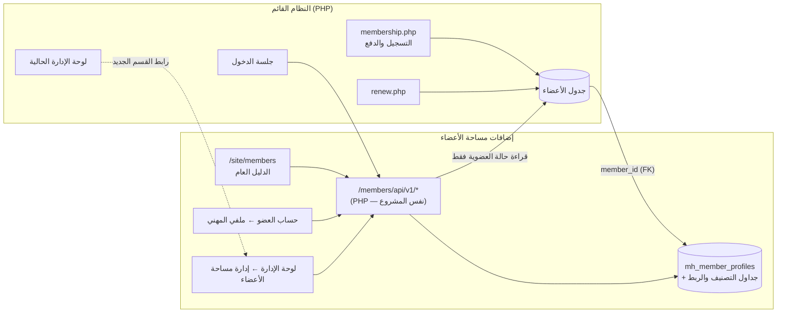
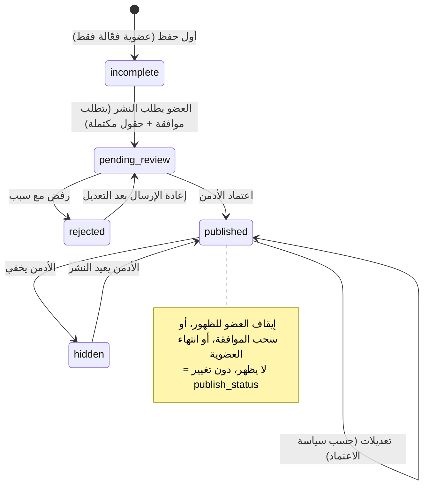

# بنية النظام المقترحة — مساحة أعضاء الجمعية

## 1. ما تم التحقق منه من الموقع الحالي (16 أكتوبر 2026)

تم فحص الصفحة العامة `https://aia.org.sa/site/` وملف الأنماط `assets/css/style.css` فقط. **لا يوجد وصول إلى الشيفرة المصدرية أو قاعدة البيانات أو لوحة الإدارة.**

| البند | النتيجة | مستوى اليقين |
|---|---|---|
| التقنية | تطبيق PHP مخصص (ملفات `.php`، لا يوجد WordPress)، خلف Cloudflare، مستضاف لدى Dimofinf، ومطوَّر من «نمير للحلول التقنية» | مؤكد من الترويسات والروابط |
| نظام العضويات | تحت `/members/`: `membership.php` (التسجيل/الدفع)، `renew.php` (التجديد) | مؤكد |
| أنواع العضوية | `type=1` عضو محترف (300 ر.س)، `type=5` عضو طالب (150 ر.س) | مؤكد من الروابط |
| مسار الرفع | `/members/assets/uploads/` | مؤكد من الروابط |
| واجهات API | `/members/api/` يعيد 403 — لا توجد واجهة عامة معروفة | لا يمكن الجزم |
| الخط | Cairo (400–900) من Google Fonts | مؤكد |
| الألوان | `--ink #08223F`، `--teal #22A599`، `--sky #00A8DF`، `--navy-mid #044869`، `--teal-light #e4f5f3`، `--line #e3e8ee`، `--bg-soft #f6f9fb`، `--muted #5a6b80` | مؤكد من CSS |
| الأيقونات | Bootstrap Icons 1.11.3 | مؤكد |
| الشكل العام | أزرار بزوايا 12px، بطاقات 14–20px، ترويسة ثابتة بخلفية شفافة وضبابية، Hero متدرج داكن (`#06263c → #0e5470`) | مؤكد |
| تسجيل الدخول للأعضاء | لا يوجد رابط ظاهر للدخول | غير معروف |
| مخطط قاعدة البيانات | — | **غير معروف** |

## 2. القرار المعماري

**الدليل امتداد لنظام العضويات القائم، وليس نظامًا موازيًا.**



- **لا تُنشأ عضوية** من الدليل. الملف المهني يرتبط بـ `member_id` الأصلي، مع قيد `UNIQUE` يمنع التكرار.
- **حالة العضوية تُقرأ وقت الطلب** من الجدول الأصلي بالـ JOIN، فلا حاجة لمزامنة أو Webhooks. تنتهي العضوية فيختفي الملف تلقائيًا، ويُجدَّد الاشتراك فيعود الملف إن كانت الموافقة والنشر قائمين.
- **وظائف التسجيل والدفع والتجديد لا تُمس.**

### خياران لتنفيذ الواجهة

| | أ) React مدمج (النموذج الحالي) | ب) قوالب PHP + JavaScript خفيف |
|---|---|---|
| الوصف | بناء `npm run build` يُنشر في `/site/members/`، ويستدعي API بـ PHP | صفحات PHP بنفس `header.php`، والفلاتر عبر fetch |
| المزايا | تفاعل غني، والمكونات جاهزة ومختبرة | توافق كامل مع القالب الحالي، وفهرسة SEO مباشرة لصفحات الأعضاء |
| العيوب | يحتاج تضمين ترويسة الموقع وتهيئة مسارات Apache/Nginx | إعادة كتابة الواجهة |
| **التوصية** | **هجين:** صفحة الملف الفردي `/site/members/{slug}` تُولَّد من PHP (لـ SEO ومعاينة الروابط عند المشاركة)، والدليل التفاعلي ولوحات العضو والإدارة بـ React | |

## 3. طبقات النموذج الأولي

```
src/
├── data/
│   ├── types.ts          نموذج النطاق + الأشكال العامة (Public DTOs)
│   ├── api.ts            ← عقد التكامل (MembersHubApi) — الحد الفاصل الوحيد
│   ├── mock/             تنفيذ وهمي داخل المتصفح يحاكي قواعد الخادم
│   ├── http/httpApi.ts   تنفيذ HTTP لنقاط النهاية الحقيقية (غير مختبر مع خادم)
│   └── index.ts          اختيار المصدر عبر VITE_DATA_SOURCE
├── lib/
│   ├── directory.ts      قواعد الظهور والبحث والتصفية والإحصائيات (دوال نقية = مواصفة الخادم)
│   ├── validation.ts     التحقق (LinkedIn، النبذة، الصور، الاكتمال)
│   └── text.ts           تطبيع النص العربي للبحث
├── components/           مكونات قابلة لإعادة الاستخدام (بطاقة، فلاتر، نموذج الملف، الموافقات…)
└── pages/                الدليل، الملف التفصيلي، ملفي المهني، لوحة الإدارة (6 أقسام)
```

الانتقال من البيانات التجريبية إلى الحقيقية **لا يتطلب تعديل أي مكون واجهة**: يكفي ضبط `VITE_DATA_SOURCE=http`، بشرط أن ينفّذ الخادم العقد الموصوف في [INTEGRATION.md](INTEGRATION.md).

## 4. قواعد العمل الجوهرية

### شرط الظهور في الدليل العام (يُتحقق منه في الخادم مع كل طلب)

```
عضوية فعّالة   (أو منتهية إذا أوقف الأدمن إعداد «الإخفاء عند الانتهاء»؛ الملغاة والموقوفة تُخفى دائمًا)
AND publish_status = 'published'
AND visibility_enabled = 1
AND consent_status = 'granted'
```

المرجع التنفيذي: `visibilityBlockers()` في [src/lib/directory.ts](../src/lib/directory.ts). تعرض لوحة الإدارة وصفحة العضو **سبب** عدم الظهور.

### دورة حياة الملف



### سياسة اعتماد التعديلات بعد النشر (قابلة للتغيير من الإعدادات)

| السياسة | الصورة، المسمى، النبذتان، LinkedIn | التخصصات، الاهتمامات، المهارات، المدينة، التعاون |
|---|---|---|
| `review_sensitive` (افتراضي) | تُعلّق في `pending_changes` وتبقى النسخة المعتمدة ظاهرة | تُطبّق فورًا |
| `review_all` | تُعلّق | تُعلّق |
| `auto` | تُطبّق فورًا | تُطبّق فورًا |

### البحث والتصفية

- **منطق الفلاتر:** شرط AND بين الفلاتر المختلفة. الاهتمامات المتعددة تطابق «أيٌّ منها» افتراضيًا، أو «جميعها» باختيار المستخدم.
- **التخصص الفرعي** يتبع المجال الرئيسي المختار، ويتصفَّر عند تغيير المجال.
- **البحث** يشمل الاسم بالعربية والإنجليزية، والمسمى، والمجالات والتخصصات (بالعربية والإنجليزية)، والمهارات، والاهتمامات. يُطبَّع النص بإزالة التشكيل والتطويل، وتوحيد «أ إ آ ← ا» و«ة ← ه» و«ى ← ي»، وتجاهل «ال» التعريف.
- **في الإنتاج:** عمود `search_text` مُطبَّع بنفس الدالة، مع فهرس `FULLTEXT ... WITH PARSER ngram`.
- **منع الاستدلال غير المباشر:** لا يمكن التصفية بنوع العضوية أو المدينة إلا لمن وافق على إظهارهما.
- **الأعداد وتوفر التخصصات** تُحسب من الملفات الظاهرة فعليًا، ولا تُعرض التخصصات الفارغة إلا بقرار من الإدارة.

## 5. الأمان وحماية الخصوصية (PDPL)

| # | الضابط | التنفيذ |
|---|---|---|
| 1 | لا نشر تلقائي | الملف الجديد `incomplete`، ولا يُنشر إلا باعتماد صريح من الأدمن |
| 2 | موافقة صريحة | مربع موافقة غير محدد مسبقًا، مع إصدار للسياسة وطابع زمني وسجل غير قابل للتعديل (`mh_consent_log`)، وموافقات حقلية (الصورة، LinkedIn، المدينة، نوع العضوية). لا يملك الأدمن منح الموافقة؛ يمكنه فقط **توثيق** موافقة خارجية مع مرجع |
| 3 | بيانات محظورة | الهوية والجوال والبريد وتاريخ الميلاد ورقم العضوية غير موجودة في الأشكال العامة أصلًا (Allow-list وليس Deny-list). يتحقق من ذلك اختبار آلي |
| 4 | لا بيانات داخلية في API عامة | `/directory/*` يعيد `PublicMemberCard/Profile` فقط، ولا يكشف `member_id`، ويستخدم slug لاتيني غير تسلسلي |
| 5 | تحقق الخادم | الأهلية والحالة والموافقة تُفحص في كل طلب عام وفي كل عملية كتابة |
| 6 | RBAC | زائر: قراءة الدليل. عضو: ملفه فقط (`member_id` من الجلسة وليس من الطلب). أدمن: صلاحية `members_directory.manage` |
| 7 | منع الأكواد الضارة | النبذة نص عادي: تُزال الوسوم وأحرف التحكم ومحارف عكس الاتجاه الخفية، ويُطبَّق escape عند العرض (React / `htmlspecialchars`)، ويُضاف CSP |
| 8 | LinkedIn | يُقبل `https://(www|xx).linkedin.com/in/{handle}` فقط، ويُطبَّع، ويُرفض ما عداه (نطاقات مشابهة، `javascript:`، بيانات اعتماد في الرابط). يُفتح بـ `rel="noopener noreferrer nofollow"` |
| 9 | رفع الصور | قائمة أنواع مسموحة مع فحص التوقيع الثنائي (magic bytes)، وحد 2MB، وأبعاد ≥ 200px، ثم **إعادة ترميز** إلى 400×400 تزيل بيانات EXIF/GPS. تُخزَّن خارج مجلد التنفيذ، باسم عشوائي، مع منع تنفيذ PHP في مجلد الرفع |
| 10 | التدقيق | كل إنشاء وتعديل واعتماد ورفض وإخفاء وموافقة ودمج وتغيير إعدادات يُسجَّل في `mh_profile_audit_logs` (أسماء الحقول دون القيم الحساسة، وIP مُجزَّأ) |
| 11 | سحب الموافقة | زر في «ملفي المهني» يُخفي الملف فورًا، ومفتاح مستقل لإيقاف الظهور. كلاهما لا يمس العضوية |
| 12 | منع الجمع الآلي | حد أقصى 24 نتيجة للصفحة، وتحديد معدل الطلبات (Cloudflare Rate Limiting + حد في التطبيق)، ولا توجد نقطة تصدير جماعي، ولا بريد أو جوال للجمع أصلًا، و`noindex` لصفحة النتائج المفلترة، وBot Fight Mode عند الحاجة |

> **حالة التنفيذ:** البنود 1–5 و7 و8 و11 منفّذة ومختبرة في النموذج الأولي، على مستوى المنطق والواجهة. البنود 6 و10 و12 تحاكيها طبقة البيانات التجريبية، ويجب تنفيذها فعليًا في الخادم. الجزء الخاص بالخادم من البند 9 (التخزين، ومنع التنفيذ في مجلد الرفع، وإعادة الترميز في PHP)، وكذلك CSP وCloudflare، كلها مطلوبة عند الدمج.

**إضافات موصى بها:** CSRF token لكل عمليات الكتابة، وكوكي الجلسة `HttpOnly; Secure; SameSite=Lax`، ومراجعة سياسة الخصوصية في `privacy.php` لإضافة بند الدليل، وتحديد مدة الاحتفاظ بسجلات التدقيق.

## 6. الأداء وقابلية التوسع

- فهارس مركبة لجداول الربط `(specialization_id, member_id)`، وفهرس الظهور `(publish_status, visibility_enabled, consent_status)`، وفهرس FULLTEXT ngram للبحث.
- ترقيم صفحات (12 افتراضيًا، 24 حدًا أقصى) مع زر «عرض المزيد».
- تخزين `meta` (الأعداد والتصنيف) مؤقتًا لمدة 5 دقائق، مع إبطال التخزين عند الاعتماد أو تعديل التصنيف.
- تحميل كسول (Lazy) لشيفرة الإدارة و«ملفي المهني»، فلا تُرسل لزوار الدليل.
- تجاهل الاستجابات القديمة عند تغيير الفلاتر بسرعة (منع سباق النتائج).
