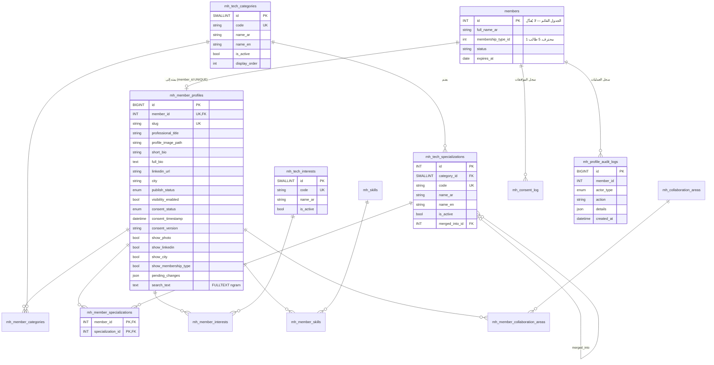

# مخطط قاعدة البيانات والعلاقات

- [schema.sql](schema.sql): إنشاء الجداول الجديدة (بالبادئة `mh_`) دون تعديل أي جدول قائم.
- [seed_taxonomy.sql](seed_taxonomy.sql): البيانات الأولية للتصنيف، مولَّدة آليًا بالأمر `node scripts/generate-seed-sql.mjs`.

> ⚠️ لم يُنفَّذ المخطط على قاعدة بيانات فعلية بعد. اسم جدول الأعضاء `members(id)` افتراضي، ويجب استبداله بالاسم والنوع الحقيقيين.

## مطابقة الجداول المنطقية المطلوبة

| المطلوب | المنفَّذ | ملاحظة |
|---|---|---|
| Members | `members` (قائم) | لا يُعدَّل |
| MemberProfiles | `mh_member_profiles` | أُضيفت: `slug`، `consent_version/source/evidence_ref`، موافقات الحقول، `pending_changes`، `rejection_reason`، `search_text`، `published_at` |
| TechCategories | `mh_tech_categories` | أُضيف `code` الثابت و`icon` |
| TechSpecializations | `mh_tech_specializations` | أُضيف `code` و`merged_into_id` لدمج المكرر |
| TechInterests | `mh_tech_interests` | |
| MemberSpecializations | `mh_member_specializations` | + `mh_member_categories` لتمثيل المجال الرئيسي المختار حتى دون تخصص فرعي |
| MemberInterests | `mh_member_interests` | |
| MemberSkills | `mh_member_skills` + `mh_skills` | المهارات مُوحّدة لمنع التكرار («python» = «Python») |
| ProfileAuditLogs | `mh_profile_audit_logs` | + `mh_consent_log` منفصل وغير قابل للتعديل لإثبات الموافقات |
| — | `mh_collaboration_areas` + `mh_member_collaboration_areas` | «المجالات التي يهتم بالتعاون فيها» |
| — | `mh_directory_settings` | سياسة الاعتماد، والإخفاء عند الانتهاء، وإظهار نوع العضوية… |

## الفهارس الأساسية

| الفهرس | يخدم |
|---|---|
| `uq_profile_member (member_id)` | منع الملفات المكررة لنفس العضو |
| `ix_profile_public (publish_status, visibility_enabled, consent_status)` | تصفية الملفات الظاهرة |
| `ft_profile_search (search_text) ngram` | البحث النصي بالعربية |
| `ix_ms_spec (specialization_id, member_id)` وما يماثله لكل جدول ربط | فلاتر التخصص والاهتمام وعدّ الأعضاء |
| `ix_audit_member (member_id, created_at)` | سجل العمليات لكل عضو |
